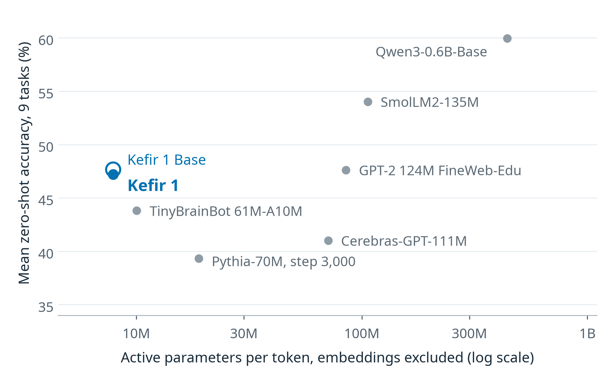
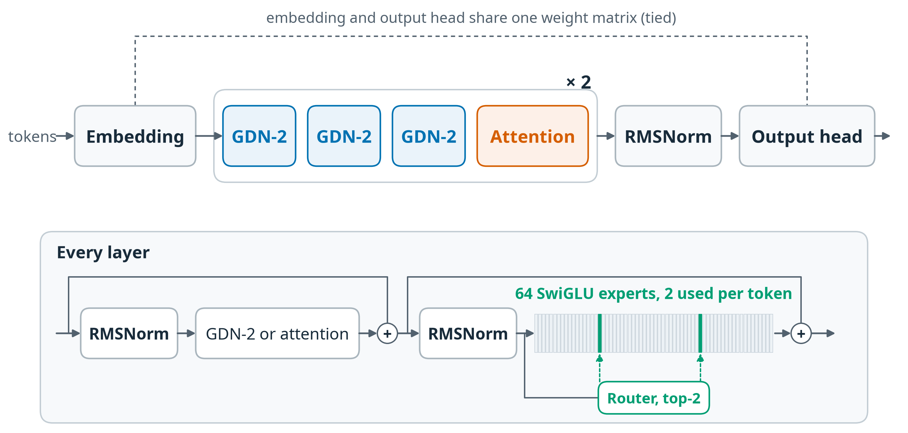

<div align="center">

<picture>
  <source media="(prefers-color-scheme: dark)" srcset="docs/kefir-logo-dark.png">
  
</picture>

<hr>

<a href="https://huggingface.co/abcastor/kefir-1"></a> <a href="https://huggingface.co/datasets/abcastor/kefir-1-sft-conversations"></a> <a href="https://huggingface.co/datasets/abcastor/kefir-1-pretraining-corpus-metadata"></a> <a href="https://huggingface.co/abcastor/superbpe-8k-english"></a> <a href="#licence"></a>

<b>A small English mixture-of-experts language model: 7.9M active non-embedding parameters (10.0M with the tied embedding), 40.6B training tokens.</b>

📊 <a href="results/benchmarks.md">Benchmarks</a> &nbsp;|&nbsp; 🧩 <a href="docs/architecture.md">Architecture</a> &nbsp;|&nbsp; 📖 <a href="docs/usage.md">Usage</a>

</div>

## Introduction

Kefir 1 is a small English mixture-of-experts language model by Edoardo Avenia and Rocco Angelella. It has
144,074,648 parameters, of which 7,890,840 non-embedding parameters are active per token (9,987,992 with the tied
embedding/output matrix). It alternates Gated DeltaNet 2 and causal attention layers, reads a 2,048-token context,
was pretrained on 40.63 billion target positions of filtered English prose, and was then fine-tuned for chat.
This repository holds the code that pretrained, fine-tuned, evaluated and serves it, and the data recipes behind it.

| Model | What it is | Weights |
|---|---|---|
| **Kefir 1** (chat) | fine-tuned on 55,490 conversations; answers in a chat format | [`abcastor/kefir-1`](https://huggingface.co/abcastor/kefir-1) |
| **Kefir 1 Base** | pretrained only, 310,000 updates; continues raw text | [`abcastor/kefir-1-base`](https://huggingface.co/abcastor/kefir-1-base) |

Intended use: research and study of small language models. Kefir 1 is not a reliable assistant.

Weights: **CC BY-NC 4.0** (non-commercial). Code and tokenizer: MIT. Details in [Licence](#licence).

## Quickstart (CPU)

With Python 3.12+ and [uv](https://docs.astral.sh/uv/). The clone is about 9 MB; the weights file is 576 MB, and
`uv sync` also installs PyTorch.

```bash
git clone https://github.com/ABCastor/kefir-1 && cd kefir-1
uv sync --locked --extra hf
uv run hf download abcastor/kefir-1 model.safetensors --local-dir weights/kefir-1
echo "5d5bcb0d13b1df69c2625f336e724a4387126c2cef39e6d16a6aded2912758fe  weights/kefir-1/model.safetensors" | sha256sum -c
uv run kefir chat --weights weights/kefir-1/model.safetensors --prompt "What is the capital of Japan?"
```

```text
Loading Kefir 1 weights...
Assistant> The capital of Japan is Tokyo.
```

Leave out `--prompt` for an interactive session. Prompt and reply share one 2,048-token budget. Kefir 1 writes
fluent English, and on most harder questions a fluent wrong answer. For Kefir 1 Base, use `kefir generate`;
options for both are in [usage](docs/usage.md).

## Evaluation

<picture>
  <source media="(prefers-color-scheme: dark)" srcset="results/figures/bench_vs_params-dark.png" width="720">
  
</picture>

*Mean zero-shot accuracy over the nine tasks in the table below, against active parameters per token with
embeddings excluded (log scale). Kefir 1 (filled) is the released chat model, scored as raw text like the base
models; Kefir 1 Base (hollow) scores 47.7 at the same size. The mean chance level of the nine
tasks is 30.6 (uniform guessing over the answer options; LAMBADA, an open-ended completion, counts as 0 %). Training tokens, estimated compute and their sources are in [benchmarks](results/benchmarks.md).*

We ran every model ourselves with lm-evaluation-harness 0.4.13, zero-shot, FP32, on an NVIDIA T4, with the same
settings for all. Kefir's SuperBPE tokenizer can merge across the prompt/answer boundary; the adapter encodes them
separately; 0.65% of requests in 5 tasks were affected and rerun. Scores are percentages. The best value in each
column is in bold. Metrics: `acc_norm` for HellaSwag, PIQA, ARC-Easy, ARC-Challenge, OpenBookQA, SciQ and SWAG; `acc` for the others.

| Model | BLiMP | LAMBADA | HellaSwag | PIQA | WinoGrande | ARC-E | ARC-C | OBQA | SciQ | Mean |
|---|---:|---:|---:|---:|---:|---:|---:|---:|---:|---:|
| Kefir 1 Base | 76.0 | 30.7 | 35.7 | 66.0 | 51.1 | 44.8 | 26.1 | 27.8 | 70.7 | 47.7 |
| Kefir 1 | 73.3 | 29.7 | 35.2 | 65.3 | 52.0 | 43.6 | 27.3 | 29.2 | 69.2 | 47.2 |
| TinyBrainBot 61M-A10M | 74.9 | 21.5 | 28.6 | 60.8 | 51.4 | 41.7 | 25.0 | 28.6 | 61.7 | 43.8 |
| Pythia-70M, step 3,000 | 71.5 | 12.1 | 26.6 | 58.4 | 51.0 | 33.7 | 21.1 | 28.2 | 51.5 | 39.3 |
| GPT-2 124M FineWeb-Edu | 80.8 | 27.9 | 33.2 | 62.7 | 51.6 | 48.4 | 25.5 | 29.8 | 68.6 | 47.6 |
| Cerebras-GPT-111M | 76.5 | 19.4 | 27.1 | 58.1 | 49.0 | 34.9 | 20.6 | 27.6 | 55.9 | 41.0 |
| SmolLM2-135M | 79.0 | 42.9 | 43.1 | 68.5 | 53.0 | **58.6** | 29.6 | 33.4 | 78.2 | 54.0 |
| Qwen3-0.6B-Base | **81.0** | **54.3** | **53.8** | **69.8** | **58.7** | 58.0 | **38.1** | **34.4** | **91.5** | **60.0** |

Kefir 1 Base beats TinyBrainBot, the model with the most similar active size, on 7 of the 9 tasks in the
table, and matches GPT-2 124M FineWeb-Edu on the nine-task mean (47.7 against 47.6), which used about 2.6 times its estimated training compute. SmolLM2-135M and Qwen3-0.6B-Base,
trained on 2 and 36 trillion tokens, beat it on every task in the table. Kefir 1 (chat) is scored as raw
text without its chat format, like the base models. The table of eight further tasks (on which, below Qwen3, every
model stays near chance on CommonsenseQA and at or below the majority class on BoolQ), checkpoints, harness
settings, sources of the parameter and token counts, TruthfulQA MC1 and WikiText bits per byte:
[results/benchmarks.md](results/benchmarks.md).
Raw scores, including all 67 BLiMP paradigms: [results/data/benchmarks.json](results/data/benchmarks.json).

## Architecture

<picture>
  <source media="(prefers-color-scheme: dark)" srcset="results/figures/architecture_overview-dark.png" width="720">
  
</picture>

| Property | Value |
|---|---|
| **Parameters** | 144.1M total; 7.9M active non-embedding per token, 10.0M with the tied embedding |
| **Layers** | 8 of width 256: `[GDN-2 × 3 → causal attention] × 2`; each a pre-norm residual token mixer, then a pre-norm residual mixture of experts |
| **Token mixers** | GDN-2: linear-recurrent, computed in chunks of 32. Attention: 4 heads × 64, rotary positions, QK normalization |
| **Experts** | 64 SwiGLU experts per layer (hidden width 352), 2 selected per token with normalized weights, no shared expert |
| **Routing** | square-root-softplus scores, quantile load balancing, no balancing loss |
| **Vocabulary** | 8,000 SuperBPE IDs; the embedding (padded to 8,192 rows) is also the output head |
| **Context** | 2,048 tokens |

Full table, parameter breakdown and detailed diagram: [architecture](docs/architecture.md).

## Training in brief

- **Corpus.** [NVIDIA Nemotron-ClimbMix](https://huggingface.co/datasets/nvidia/Nemotron-ClimbMix), filtered for
  English prose (code, symbolic mathematics, boilerplate, non-Latin script and poor English removed), cleaned of
  overlap with the validation split and packed into 2,049-token training records (2,048 targets each). Recipe:
  [data/pretraining](data/pretraining/README.md).
- **Pretraining.** 310,000 updates of 131,072 target positions: 40,632,320,000 target positions in total,
  end-of-document padding included. The last 30,000 updates are a cooldown that took held-out loss from 2.639
  to 2.531 nats per target.
- **Fine-tuning.** 55,490 English conversations selected from a [pool of
  200,000](https://huggingface.co/datasets/abcastor/kefir-1-sft-labelled-pool) labelled by an open-weights decision
  model, with 512 more held out; selection code in [data/sft](data/sft/README.md). A shared run to 15,000
  conversations was continued twice on the same 40,490 conversations, with and without a System prompt added to
  16,193 of them; the System-prompt arm is Kefir 1. One run per arm.

Loss curves and every measured table: [results](results/README.md). How to rerun each stage:
[training](docs/training.md), [evaluation](docs/evaluation.md), [method](docs/method.md),
[provenance](docs/provenance.md).

What ships here: the model, pretraining, fine-tuning, evaluation and chat code; the data recipes in
[`data/`](data/README.md): the pretraining corpus recipe ([`data/pretraining`](data/pretraining/README.md)), the SFT
data selection ([`data/sft`](data/sft/README.md): judge questions, filters, thresholds, overlap removal and
stratified cohorts, with a generic judge interface for any model or API) and the tokenizer
([`data/tokenizer`](data/tokenizer/README.md)); the lm-evaluation-harness adapter used for the comparison above
([`results/bench_lm.py`](results/bench_lm.py)); and the measured data. What does not: the original corpus filter
classifiers (`students.pkl`, in a separate Hugging Face repository) and the script that added
System prompts to the fine-tuning conversations.

## Limitations

- **English prose only.** Code, symbolic mathematics and non-English text were filtered out of the training data.
- **2,048 tokens** for the whole conversation and the reply; older exchanges are dropped in chat.
- **Factual reliability is low.** Answers are often fluent and wrong. On the development split of our chat suite,
  exact match was 0 for context use, natural reasoning and open knowledge questions.
- **No safety tuning** and no safety, identity or long-context evaluation.
- **Thin statistics.** One pretraining run, one run per fine-tuning arm, no standard errors on the benchmarks.
  Overlap between the benchmarks and the pretraining corpus was not checked.
- Lower held-out loss during fine-tuning did not bring better chat-suite scores; details in
  [results](results/README.md#supervised-fine-tuning).

## Related artifacts

- [Kefir 1 SFT-15k](https://huggingface.co/abcastor/kefir-1-sft-15k): the shared 15,000-conversation parent of both
  fine-tuning arms.
- [SuperBPE tokenizer](https://huggingface.co/abcastor/superbpe-8k-english): the pinned 8,000-ID vocabulary.
- [Pretraining corpus metadata](https://huggingface.co/datasets/abcastor/kefir-1-pretraining-corpus-metadata).
- [Fine-tuning pool](https://huggingface.co/datasets/abcastor/kefir-1-sft-labelled-pool): 200,000 labelled
  conversations.
- [Kefir 1 Corpus Filters](https://huggingface.co/abcastor/kefir-1-corpus-filter): the original `students.pkl`
  bundle. Download and verification: [corpus recipe](data/pretraining/README.md#environment-and-assets).

## Licence

Repository code and the tokenizer are released under the MIT licence. Model weights, the pretraining corpus and
the shipped thematic text panels are released under CC BY-NC 4.0. Fine-tuning conversations keep the terms of
their upstream sources. See [LICENSE](LICENSE) and [NOTICE](NOTICE.md) for exact scopes and acknowledgments.

Questions and bug reports: [GitHub issues](https://github.com/ABCastor/kefir-1/issues).

<p><a href="https://abcastor.com"><picture>
  <source media="(prefers-color-scheme: dark)" srcset="results/figures/castor-footer-dark.png" width="350">
  
</picture></a></p>
