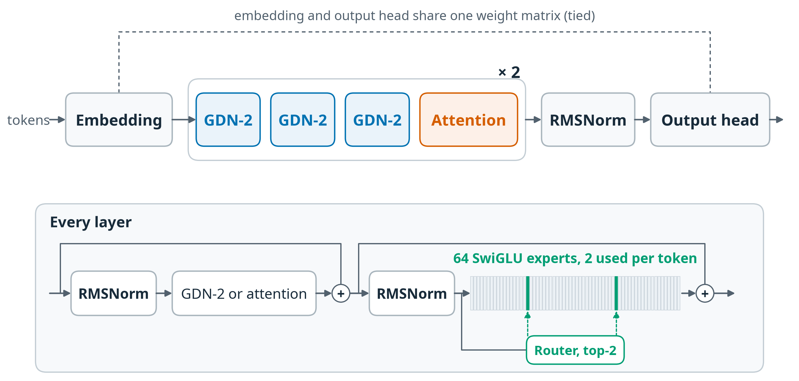
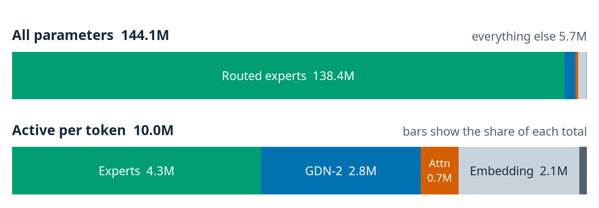
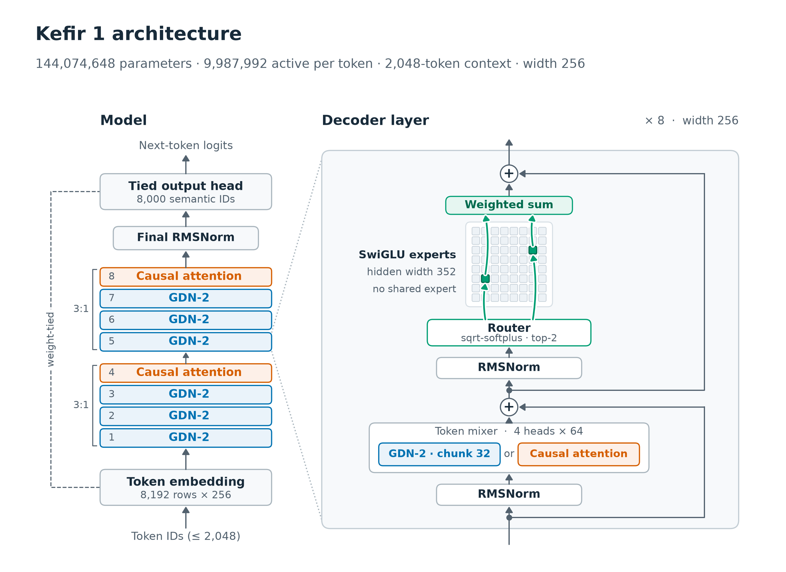

# Kefir 1 architecture

<picture>
  <source media="(prefers-color-scheme: dark)" srcset="../results/figures/architecture_overview-dark.png" width="760">
  
</picture>

Kefir 1 is a decoder-only language model with eight layers in the pattern `[GDN-2 × 3 → causal attention] × 2`.
Every layer has two pre-norm residual parts. The first is a **token mixer**: Gated DeltaNet 2 (GDN-2), which is
linear-recurrent, or full causal attention. The second is a **mixture of 64 SwiGLU experts**, of which a router
picks 2 per token. Kefir 1 Base and the chat model Kefir 1 share this architecture and differ only in their
weights.

## Model summary

| Property | Value |
|---|---|
| **Architecture** | Decoder-only hybrid: Gated DeltaNet 2 and causal attention, mixture-of-experts feed-forward |
| **Total parameters** | 144,074,648 |
| **Active parameters per token** | 9,987,992 (7,890,840 without the tied embedding) |
| **Number of layers** | 8 |
| **Layer pattern** | `[GDN-2, GDN-2, GDN-2, attention] × 2`: 6 GDN-2 layers, 2 attention layers (3:1) |
| **Hidden size** | 256 |
| **Attention** | 4 heads × 64, full causal, rotary positions (base 10,000), QK RMSNorm, sigmoid output gate |
| **GDN-2** | 4 key heads × 64 and 4 value heads × 64, short convolution (kernel 4) on q, k, v, chunked computation (chunk 32), low-rank (64) decay and output gates |
| **MoE layers** | all 8 |
| **Number of experts** | 64 routed, no shared expert |
| **Selected experts per token** | 2 |
| **Expert hidden size** | 352 |
| **Activation function** | SwiGLU |
| **Router** | square-root-softplus scores, normalized top-2 weights, quantile load balancing, no auxiliary loss |
| **Dispatch** | dropless (padded batched GEMM) |
| **Normalization** | pre-norm RMSNorm (ε = 10⁻⁶) and a final RMSNorm |
| **Vocabulary** | 8,000 SuperBPE token IDs; embedding padded to 8,192 rows and tied to the output head |
| **Context length** | 2,048 tokens |
| **Training precision** | BF16 |
| **Released weights** | FP32 `.safetensors`, 576 MB per model |
| **Modality** | English text |

## Where the parameters are

<picture>
  <source media="(prefers-color-scheme: dark)" srcset="../results/figures/architecture_params-dark.png" width="760">
  
</picture>

| Component | All parameters | Active per token |
|---|---:|---:|
| Routed experts (64 per layer × 8, 270,336 each) | 138,412,032 | 4,325,376 (2 per layer) |
| GDN-2 mixers (6 layers) | 2,774,424 | 2,774,424 |
| Attention mixers (2 layers) | 655,616 | 655,616 |
| Tied embedding and output head (8,192 × 256) | 2,097,152 | 2,097,152 |
| Routers (8 × 64 × 256) | 131,072 | 131,072 |
| RMSNorm weights | 4,352 | 4,352 |
| **Total** | **144,074,648** | **9,987,992** |

The counts come from the model definition in `src/kefir/model/`. The figure is drawn by
[`results/make_param_breakdown.py`](../results/make_param_breakdown.py).

## Inside a layer

<picture>
  <source media="(prefers-color-scheme: dark)" srcset="../results/figures/architecture-dark.png" width="760">
  
</picture>

Training details are in [method](method.md#model); measured results are in [results](../results/README.md). The
maintainer record of the code (entries, authorities, what ran versus what is new, equivalence evidence) is in
[code-record.md](code-record.md).
