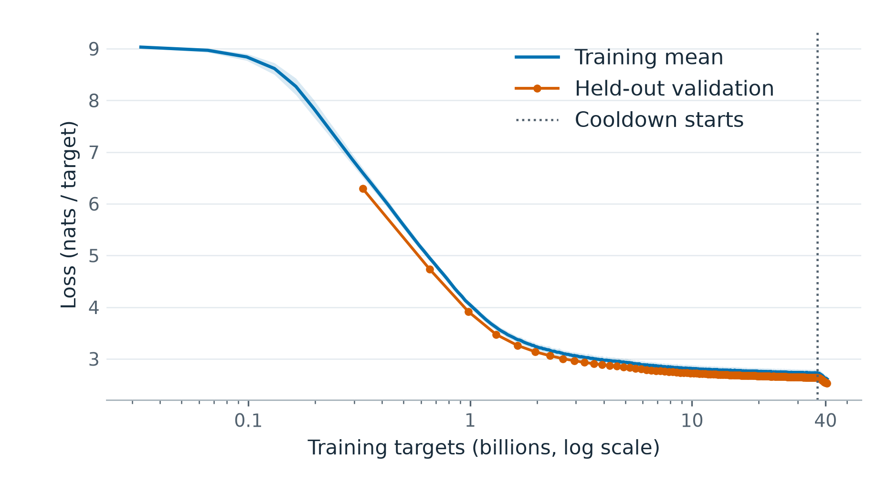
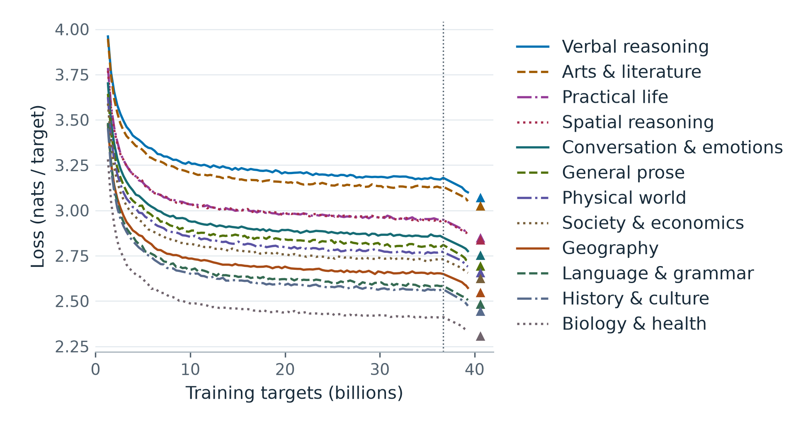
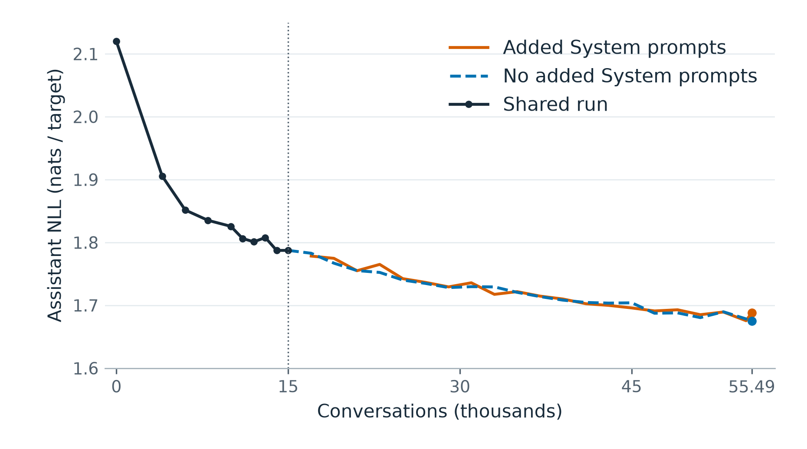

# Kefir 1 — measured results

Measurements for Kefir 1: pretraining (run 003 plus a 30,000-update cooldown, ending at step
310,000) and supervised fine-tuning (SFT) through 55,490 chats, including the 15,000-chat screen and both continuation arms. All tables below are read from
`data/`; the nine measurement figures are drawn from `data/` by `make_figures.py`, and the zero-shot comparison
([benchmarks.md](benchmarks.md) and its two figures) by `make_benchmarks.py` from `data/benchmarks.json`.
The architecture diagram is owned separately by `make_architecture.py`; the measurement generator never writes
`architecture.svg` or `architecture.png`.

```bash
python results/make_figures.py      # needs matplotlib and rsvg-convert; writes measurement SVGs and PNGs
```

The script reads only `results/data/`, uses no network and is deterministic for a given matplotlib version
(figures here were drawn with matplotlib 3.11.0).

**Reading conventions.** *Measured* = a value recorded by the training or evaluation code. *Derived* = computed
here from measured values; the formula is given. Every SFT arm except where noted is **one training run with one
data-order seed**: differences between arms are indicative, not statistically established. Missing cells are
missing measurements, never zeros. The zero-shot comparison with external models (lm-evaluation-harness) is in
[benchmarks.md](benchmarks.md).

## Model

| | |
|---|---|
| Architecture | hybrid Gated DeltaNet / attention (pattern GDN, GDN, GDN, MHA ×2), every layer a top-2 mixture of experts |
| Size | d_model 256, 8 layers, 4 attention heads × 64, 64 SwiGLU experts per layer (hidden 352), top-2 routing |
| Parameters | **144,074,648 total** (measured: counted on the loaded model) / **9,987,992 active per token** (derived: total − all expert weights + 2 experts per layer, expert = 3 × 256 × 352) / **7,890,840 active non-embedding** (derived: active minus the tied 8,192 × 256 embedding/output matrix, 2,097,152) |
| Tokenizer | SuperBPE, 8,000 semantic tokens (8,192 padded), sha256 `068e20ef…376d373bb` |
| Context | 2,048 tokens |

Source: `data/model.json`.

## Pretraining

| Quantity | Value | Kind |
|---|---:|---|
| Updates | 310,000 (run 003: 280,000; cooldown C30: 30,000) | measured |
| Targets per update | 131,072 (global batch 64 × 2,048) | measured |
| Targets seen | 40,632,320,000 (cooldown: 3,932,160,000 = 9.68 %) | measured / derived |
| LR schedule | linear warm-up to 3e-4 (reached at step 38,147), constant to 280,000, cosine to 3e-5 at 310,000 | measured (logged LR) |
| Optimizer | hybrid Muon / AdamW, BF16 | recorded config |
| Validation (2,097,152 targets) at 280,000 → 310,000 | 2.638766 → **2.530763** nats/target | measured |
| Validation perplexity | 13.9959 → **12.5631** (**−10.24 %**) | derived, exp(loss) |
| Recorded update time | run 003: 28.76 h on 1 GPU (H100 per the run report); C30: 60.60 h on 2× T4 | measured, sum of per-update durations; excludes validation, saving, idle, queue; not billed hours |
| C30 median throughput | 18,944 targets/s on 2× T4 | derived |

### Loss curves

<picture>
  <source media="(prefers-color-scheme: dark)" srcset="figures/pretrain_loss-dark.png" width="620">
  
</picture>

*Training loss (10th–90th percentile band) and held-out loss, measured on separate text splits.*

<picture>
  <source media="(prefers-color-scheme: dark)" srcset="figures/pretrain_themes-dark.png" width="520">
  
</picture>

*Held-out loss on 12 thematic validation subsets: it shows which kinds of text are harder to predict, not task accuracy.*

### Cooldown checkpoints (`data/pretrain_checkpoints.csv`)

| Step | Validation CE (BF16, logged) | Perplexity | 12-theme weighted CE (CPU FP32) | Shared-text bits/byte (CPU FP32) |
|---:|---:|---:|---:|---:|
| 280,000 | 2.638766 | 13.9959 | 2.786198 | 0.931155 |
| 295,000 | 2.589029 | 13.3168 | 2.734485 | 0.918106 |
| 310,000 | 2.530763 | 12.5631 | 2.677018 | 0.904261 |

Shared-text bits/byte scores 384 held-out documents. 310,000 vs 280,000: −0.026894 bits/byte, 95 % paired document
bootstrap [−0.028143, −0.025714], 374 of 384 documents improve. The interval covers document resampling only, not
training seeds. All 12 thematic panels improve (−0.099 to −0.122 nats, `data/pretrain_themes_endpoints.csv`).

### Behaviour probes (`data/pretrain_probes.csv`)

Small hand-written diagnostics scored by log-probability of supplied answer candidates; one item moves a score.

| Probe | 280,000 | 295,000 | 310,000 |
|---|---:|---:|---:|
| Facts (4-choice) | 15/24 | 17/24 | 19/24 |
| Grammar (2-choice) | 23/24 | 23/24 | 22/24 |
| Arithmetic | 4/12 | 5/12 | 6/12 |
| Capital choice | 3/6 | 4/6 | 6/6 |
| Retrieval, reversal pairs both correct | 2/16 | 1/16 | 4/16 |
| Composition, reversal pairs both correct | 1/16 | 0/16 | 0/16 |
| Free generations ending with end-of-document within 48 tokens | 0/95 | 0/95 | 0/95 |

None of the 95 free-generation probes ended with EOD within 48 tokens. Likelihood gains do not establish
a reasoning improvement.

## Supervised fine-tuning

**Setup** (`data/sft_data.json`). Parent: pretraining step 310,000. Data: 10,000 whole English chats, then 5,000
further unseen chats for the continuation (15,000 total, **10,493,117 assistant targets**; 7,036,586 in the first
10,000), each chat seen once. Validation: 512 disjoint chats, 364,453 assistant targets. Loss: mean NLL over
assistant tokens including the end-of-turn token. Hardware: 2× T4, FP16, micro-batch 2 per GPU, context 2,048.
Optimizer: hybrid Muon/AdamW, fresh state, clipping 1.0, peak LR 3e-5.

**Arms** (`data/sft_trajectories.csv`). *flat*: constant 3e-5. *late decay*: fork of a flat run at 10,000 chats,
cosine 3e-5 → 3e-6 over the last 5,000. *warm-up + decay*: 512-chat warm-up, then decay to 3e-6 at 15,000.
*warm-up + stable + decay*: same warm-up, flat until the target count of the first 5,000 chats, then decay to 3e-6.
Seeds 17/18 change the order and identity of chats, not the parent. Batch 16 (both seeds) and flat batch 32 seed 18
were planned but **never ran**.

### Results at 15,000 chats (`data/sft_evaluations.csv`)

| Arm | Val NLL | Val ppl | BLiMP /64 | ARC raw /30 | Instr. constraints /36 | Stopping /16 | Open80 native end /80 | Raw-fact bits/byte |
|---|---:|---:|---:|---:|---:|---:|---:|---:|
| Parent (step 310,000) | 2.120111 | 8.332 | 50 | 18 | 5 | 2 | 8 | 1.188 |
| **flat, batch 32, seed 17** | **1.787421** | **5.974** | 52 | 17 | 16 | 9 | 48 | 1.310 |
| flat, batch 64, seed 17 | 1.822140 | 6.185 | 50 | 17 | 14 | 8 | 53 | 1.330 |
| late decay, batch 32, seed 17 | 1.800617 | 6.053 | 49 | 15 | 12 | 9 | 58 | 1.339 |
| late decay, batch 64, seed 17 | 1.839937 | 6.296 | 50 | 17 | 13 | 6 | 50 | 1.324 |
| warm-up + decay, seed 17 | 2.048505 ¹ | 7.756 | 49 | 14 | 9 | 5 | 42 | 1.428 |
| warm-up + decay, seed 18 | 1.825333 | 6.205 | 51 | 17 | 14 | 6 | 58 | 1.305 |
| warm-up + stable + decay, seed 17 | 1.809769 | 6.109 | 50 | 17 | 13 | 9 | 58 | 1.306 |
| warm-up + stable + decay, seed 18 | 1.813142 | 6.130 | 49 | 18 | 13 | 8 | 55 | 1.330 |
| flat, batch 64, seed 18 (10,000 chats only) | 1.851869 | 6.372 | 51 | 18 | 9 | 2 | – | – |

At 10,000 chats: flat batch 32 seed 17 1.825673, flat batch 64 seed 17 1.855528, seed 18 1.851869. Lowest NLL in the 15,000-chat screen:
flat, batch 32, seed 17, validation NLL 1.787421 vs parent 2.120111 (−0.3327 nats, perplexity
−28.3 %, derived). Exact-match scores of the same suite are 0 for every model and checkpoint: context use (0/48,
paired 0/24), natural reasoning (0/32), open knowledge answers (0/62). Exact match is a lower bound; it penalises
verbose or partly correct answers.

¹ Single evaluations, not repeated: warm-up + decay seed 17 at 15,000 (2.0485, after 1.8364 at 10,000) and late
decay batch 32 at 14,000 (1.9147, then 1.8006 at 15,000). Treat these points as unconfirmed until re-measured.

Metric definitions (frozen development split, 254 cases, greedy decoding, native end-of-turn only):
BLiMP = grammatical sentence of a minimal pair preferred (8 paradigms); ARC raw = ARC-Easy answer chosen by raw
log-probability; instruction constraints = individual checkable constraints met across 32 tasks; stopping =
dedicated cases ended with the model's own end token; Open80 native end = of 80 open questions, answers ended by
the model rather than the output cap; raw-fact bits/byte = likelihood of 62 canonical short answers without chat
formatting (higher means less probability on the reference answer, not more wrong answers).

### Compute (`data/sft_jobs.csv`, `data/sft_segments.csv`, `data/sft_timing_fixture.csv`)

| Measure | Batch 32 | Batch 64 |
|---|---:|---:|
| Median seconds per optimizer update, 2× T4 | 11.7 (flat, seed 17); 12.9 (seed 18 schedule arms) | 22.3–23.0 |
| Optimizer time, first 10,000 chats | 61.4 min | 60.1 min (seed 17), 59.7 min (seed 18) |
| Optimizer time, 5,000-chat continuation | 30.5 min | 29.2 min |
| Assistant targets per second | ≈ 1,900 | ≈ 1,960 |
| Peak allocated memory per GPU | 13.2 GiB | 13.3 GiB |
| Updates clipped (flat, 0–10k) | 100 % | 57 % (seed 17), 54 % (seed 18) |

Nine admitted 2× T4 jobs: **34.55 T4-hours** (17.28 worker hours × 2 GPUs): batch screen and continuations 13.67,
schedule and late-decay forks 20.88. Worker time includes evaluations and checkpoint saves, excludes queueing and
provider start-up, one failed first continuation attempt, timing tests and inference demos. No overflow retries
occurred. A separate timing fixture with long (≥ 1,536-token) sequences at global batch 64 measured 22.06 s per
update on 2× T4 and 41.71 s on 1× T4.

### Long fine-tuning, 15,000 → 55,490 chats (`data/sft_long_validation.csv`, `data/sft_long_benchmarks.csv`)

The flat batch 32 seed 17 state at 15,000 chats continued over 40,490 further unseen conversations (28,862,303
assistant targets; 55,490 chats and 39,355,420 assistant targets in total, update 1,736) in two arms with the same
conversations and order: `no_system` (unchanged data) and `system_prompt` (a System prompt added to 16,193 of the
40,490 conversations). Measured.

- `sft_long_validation.csv` — held-out assistant NLL on the same 512 validation conversations, at every saved
  checkpoint, in two renderings: `native` (the conversations as they are) and `brief_system` (one added System
  message: "Answer directly and briefly. If the user gives you information, base your answer on it."). Rows before
  15,000 chats are the shared lineage. `val_perplexity` is derived, exp(NLL).
- `sft_long_benchmarks.csv` — the development split of `kefir-bench/1`, the Open80 ending count and the raw-fact
  probe at each of the 22 points per arm (the 15,000-chat parent appears in both arms), under the same two
  conditions, with the SHA-256 of the weights scored. Evaluated after training on CPU in FP32, so the 15,000-chat
  row differs slightly from the FP16 in-loop row of `sft_evaluations.csv` (ARC raw 16 vs 17, stopping 8 vs 9, Open80
  49 vs 48, raw-fact 1.308 vs 1.310). Grammar, ARC and the raw-fact probe do not use chat messages, so their two
  condition rows are the same measurement, not a replication.

| Endpoint | 15,000 (parent) | 55,490 `no_system` | 55,490 `system_prompt` |
|---|---:|---:|---:|
| Val NLL, native | 1.787421 | 1.674787 | 1.688240 |
| Val NLL, brief System | – | 1.677910 | 1.689249 |
| BLiMP /64 | 52 | 49 | 49 |
| ARC raw /30 | 16 | 18 | 17 |
| Instruction constraints /36, native / brief System | 16 / 11 | 13 / 16 | 13 / 15 |
| Stopping /16, native / brief System | 8 / 12 | 8 / 13 | 9 / 12 |
| Open80 native end /80, native / brief System | 49 / 73 | 58 / 68 | 54 / 70 |
| Raw-fact bits/byte | 1.3082 | 1.2321 | 1.2896 |

One run per arm. The benchmark counts move in mixed directions as the NLL falls: ARC raw rises from 16 to 18 and
17, BLiMP falls by 3 and native instruction constraints by 3; no checkpoint is shown to be better than the
15,000-chat parent on them. The `system_prompt` arm has its lowest native NLL at 55,000 chats (1.675487) and is
slightly worse at the last point. The shared run and both continuations appear in the held-out NLL figure:

<picture>
  <source media="(prefers-color-scheme: dark)" srcset="figures/sft_long_nll-dark.png" width="620">
  
</picture>

*Native held-out assistant NLL (nats per target) across the same 512 validation conversations for both continuation arms, with one run per arm.*

## Figures (`figures/`, SVG and PNG)

- `architecture` — detailed model diagram, owned by `make_architecture.py`, separate from the measurement generator.
- `architecture_overview` — simplified wide diagram for the top-level README, same owner.
- `bench_vs_compute`, `bench_vs_params` — mean zero-shot accuracy over nine tasks (Kefir 1 filled, Kefir 1 Base hollow) against estimated pretraining compute
  and against active non-embedding parameters, owned by `make_benchmarks.py`.
- `sft_long_nll` — shared 15,000-chat lineage and both 55,490-chat continuations, native held-out assistant NLL.
- `pretrain_loss` — training loss (mean and 10th–90th percentile of 250-update windows; variability, not a
  confidence interval) and validation loss over the full run (logarithmic target count). Measured; train and
  validation use different text, so their gap is not a generalisation gap.
- `pretrain_lr` — learning rate as logged at the end of each 250-update window. Measured.
- `pretrain_themes` — 12 BF16 trajectories on shared axes from step 10,000, through the last BF16 thematic
  log at step 299,807. Separate triangles are the final CPU FP32 measurements. The vertical dotted line
  marks the start of the cooldown. The panels measure loss on keyword-assigned text.
- `sft_validation_nll` — validation assistant NLL vs chats seen for (a) the batch screen, (b) the schedules, (c) the
  late-decay forks. Measured; one seed per line; two unrepeated outliers are marked.
- `sft_train_loss` — training NLL, target-weighted over 500-chat bins. Measured; batches differ in content, so
  bin-to-bin noise is data, not instability.
- `sft_lr_schedules` — learning rate as logged for the four schedules (batch 32, seed 17). Measured.
- `sft_benchmarks` — frozen benchmark scores vs chats seen for the flat batch-screen arms. Measured; small item counts,
  one item moves a score by one.
- `sft_endpoints_15k` — numeric comparison of every arm at 15,000 chats on validation NLL and six benchmark measures,
  with the pretrained parent as reference.
  Measured; no aggregate score or winner is implied.

## Gaps and limits

- Batch 16 and flat batch 32 seed 18 were never run; only batch 64 has two seeds for the flat 10k pass; the late-decay
  forks have one seed; seed 18 at batch 64 has no Open80 or raw-fact measurements.
- Pretraining has one seed and no constant-LR or alternative-decay control: the cooldown's gain mixes extra tokens and
  lower LR.
- Confirmation (512 cases) and reserve (256 cases) benchmark splits were never evaluated; development curves were
  used for comparison only.
- The long fine-tuning has one run per arm and no recorded total compute time in these tables.
- Per-conversation validation losses were not saved, so subgroup losses and their variance are unavailable.
- No safety, identity or long-context evaluation. The external-model comparison ([benchmarks.md](benchmarks.md)) has no
  standard errors and no check of benchmark overlap with the pretraining corpus.
- SFT time excludes provider queueing; pretraining time is recorded update time, not billed GPU-hours.
