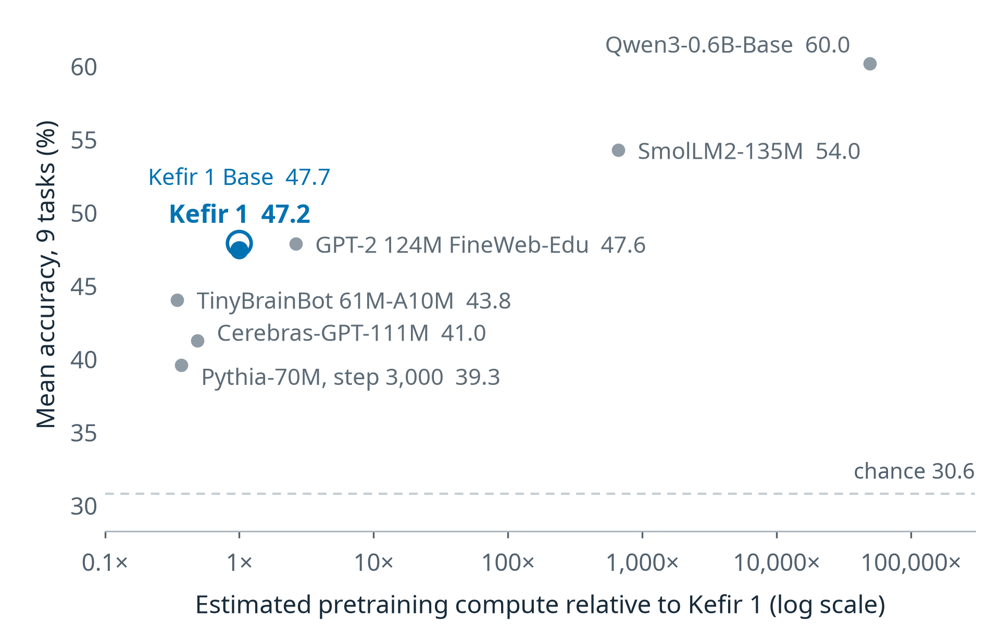

# Zero-shot benchmarks

Kefir 1 Base, Kefir 1 and six small open base models, all evaluated by us with the same harness and
settings. This page is written by [`make_benchmarks.py`](make_benchmarks.py) from
[`data/benchmarks.json`](data/benchmarks.json), which holds every score, including the 67 BLiMP paradigms.

## Settings

- lm-evaluation-harness (lm_eval) 0.4.13, 0-shot, FP32, NVIDIA T4, batch size 64, no sample
  limit, `random_seed=0`, `numpy_random_seed=1234`,
  `torch_random_seed=1234`.
- Baselines: lm_eval HFLM, dtype float32; TinyBrainBot with trust_remote_code.
- Kefir 1 and Kefir 1 Base: custom lm_eval LM class: trailing context whitespace moved to the continuation (as lm-eval does), then context and continuation encoded separately with the pinned tokenizer and concatenated, every continuation token scored, EOD (7992) prepended as document start, right padding, FP32; an input longer than the context keeps its last 2,049 tokens (2,048 input positions).
- Kefir's SuperBPE tokenizer can merge across the prompt/answer boundary; the adapter encodes them separately; 0.65% of
  requests in 5 tasks were affected and rerun.
- No standard errors were computed (`bootstrap_iters=0`). Qwen3-0.6B-Base WikiText ran out of T4 memory and is
  missing.
- Every model scored the same items; sample counts are those of the harness tasks (for example HellaSwag 10,042,
  ARC-Easy 2,376, BLiMP 67,000).
- Kefir 1 is scored as raw text, without its chat template, like the base models.
- Overlap between these benchmarks and the Kefir 1 pretraining corpus was not checked.
- To rerun one model: `PYTHONPATH=src python results/bench_lm.py kefir:path/to/model.safetensors out.json`
  (or `hf:repo_id[@revision]` for a baseline). It needs `lm_eval[hf]==0.4.13`. The script is
  [`bench_lm.py`](bench_lm.py). Without `--tasks` it runs the nine core tasks; the 17 tasks of the tables below,
  plus TruthfulQA MC1 and WikiText, are
  `--tasks blimp,lambada_openai,hellaswag,piqa,winogrande,arc_easy,arc_challenge,openbookqa,sciq,social_iqa,copa,swag,race,commonsense_qa,boolq,wsc273,truthfulqa_mc2,truthfulqa_mc1,wikitext`.
- TinyBrainBot ships its own model code, so its spec needs the `+trc` suffix
  (`hf:nkthebass/tinybrainbot-61m-a10m-v4.1-moe-base+trc`), which passes `trust_remote_code=True` and runs
  third-party code from that repository. The revision used was not recorded; review the code at the revision you
  pin (`hf:repo@revision+trc`) before running it.

Scores are percentages; higher is better except where marked ↓. The best value in each column is in bold.
Metrics: BLiMP `acc`, LAMBADA `acc`, HellaSwag `acc_norm`, PIQA `acc_norm`, WinoGrande `acc`, ARC-E `acc_norm`, ARC-C `acc_norm`, OBQA `acc_norm`, SciQ `acc_norm`, SocialIQA `acc`, COPA `acc`, SWAG `acc_norm`, RACE `acc`, CSQA `acc`, BoolQ `acc`, WSC273 `acc`, TQA MC2 `acc`.

## Models

Compute is estimated as **6 × active non-embedding parameters × training tokens**. It ignores attention and
recurrent-state FLOPs, tokenizer differences (a token is not the same amount of text across models) and hardware
efficiency; it is a coarse scale, not a measurement. For Kefir 1 and Kefir 1 Base, the active count excludes the tied 8,192 × 256
embedding/output matrix (9,987,992 − 2,097,152 = 7,890,840) and the tokens are the 40,632,320,000 target
positions seen in pretraining, end-of-document padding included.

| Model | Checkpoint | Active non-embedding parameters | Training tokens | Estimated compute (FLOPs) |
|---|---|---:|---:|---:|
| Kefir 1 Base | `abcastor/kefir-1-base` | 7.89M | 41B | 1.9×1018 |
| Kefir 1 | `abcastor/kefir-1` | 7.89M | 41B | 1.9×1018 |
| TinyBrainBot 61M-A10M | `nkthebass/tinybrainbot-61m-a10m-v4.1-moe-base` | 10M | 11B | 6.6×1017 |
| Pythia-70M, step 3,000 | `EleutherAI/pythia-70m@step3000` | 19M | 6.3B | 7.1×1017 |
| GPT-2 124M FineWeb-Edu | `rhysjones/gpt2-124M-edu-fineweb-10B` | 85M | ~9.9B | ~5.1×1018 |
| Cerebras-GPT-111M | `cerebras-archive/Cerebras-GPT-111M` | 71M | 2.2B | 9.4×1017 |
| SmolLM2-135M | `HuggingFaceTB/SmolLM2-135M` | 106M | 2T | 1.3×1021 |
| Qwen3-0.6B-Base | `Qwen/Qwen3-0.6B-Base` | 440M | 36T | 9.5×1022 |

| Model | Parameter count source | Token count source |
|---|---|---|
| Kefir 1 Base | results/data/model.json and the weights header: 9,987,992 active minus the tied 8,192 x 256 embedding (2,097,152) | results/data/pretrain_summary.json targets_total (target positions including end-of-document padding) |
| Kefir 1 | as Kefir 1 Base | pretraining only; fine-tuning adds at most 55,490 x 2,048 = 113,643,520 positions (under 0.3 %) |
| TinyBrainBot 61M-A10M | config (hidden 256, 14 layers, 16 experts top-2, SwiGLU 336, vocab 14000 tied): 10,042,624 active non-embedding; the card's A10M excludes the 3.6M tied embedding | model card: 11.0B tokens |
| Pythia-70M, step 3,000 | model card: 18,915,328 non-embedding parameters | 3,000 steps x 2,097,152 tokens per step (model card batch size) |
| GPT-2 124M FineWeb-Edu | config shape (12 layers, width 768, vocab 50257, 1024 positions, tied): 124,439,808 total minus 38,597,376 token and 786,432 position embedding = 85,056,000 | model card command: llm.c train_gpt2cu over edu_fineweb10B with -d 458752 and no -x, so one epoch of the training shards (llm.c: "-x ... -1 (default) = disable, run 1 epoch"; -n 5000 is the checkpoint interval); about 9.9B tokens, consistent with the card's 20 h on one RTX 4090; inferred, the card states no token count |
| Cerebras-GPT-111M | paper arXiv 2304.03208 Table 1 shape (width 768, 10 layers, FFN 3072): 70,880,256 non-embedding (HF config not reachable) | paper arXiv 2304.03208 Table 1: 2.2B tokens |
| SmolLM2-135M | config (width 576, 30 layers, MLP 1536, vocab 49152 tied): 106,203,456 non-embedding | model card: 2T pretraining tokens |
| Qwen3-0.6B-Base | model card: 0.44B non-embedding; config arithmetic 440,467,456 | model card: pre-trained on 36 trillion tokens |

<picture>
  <source media="(prefers-color-scheme: dark)" srcset="figures/bench_vs_compute-dark.png" width="720">
  
</picture>

*Mean zero-shot accuracy over the nine core tasks against estimated pretraining compute relative to Kefir 1
(log scale; Kefir 1 ≈ 1.9 × 10¹⁸ FLOPs). Kefir 1 (filled) and Kefir 1 Base (hollow) share the same pretraining
compute. Dashed line: mean chance level of the nine tasks (LAMBADA, an open-ended completion, counts as 0 %).*

## Nine core tasks

| Model | BLiMP | LAMBADA | HellaSwag | PIQA | WinoGrande | ARC-E | ARC-C | OBQA | SciQ | Mean |
|---|---:|---:|---:|---:|---:|---:|---:|---:|---:|---:|
| Kefir 1 Base | 76.0 | 30.7 | 35.7 | 66.0 | 51.1 | 44.8 | 26.1 | 27.8 | 70.7 | 47.7 |
| Kefir 1 | 73.3 | 29.7 | 35.2 | 65.3 | 52.0 | 43.6 | 27.3 | 29.2 | 69.2 | 47.2 |
| TinyBrainBot 61M-A10M | 74.9 | 21.5 | 28.6 | 60.8 | 51.4 | 41.7 | 25.0 | 28.6 | 61.7 | 43.8 |
| Pythia-70M, step 3,000 | 71.5 | 12.1 | 26.6 | 58.4 | 51.0 | 33.7 | 21.1 | 28.2 | 51.5 | 39.3 |
| GPT-2 124M FineWeb-Edu | 80.8 | 27.9 | 33.2 | 62.7 | 51.6 | 48.4 | 25.5 | 29.8 | 68.6 | 47.6 |
| Cerebras-GPT-111M | 76.5 | 19.4 | 27.1 | 58.1 | 49.0 | 34.9 | 20.6 | 27.6 | 55.9 | 41.0 |
| SmolLM2-135M | 79.0 | 42.9 | 43.1 | 68.5 | 53.0 | **58.6** | 29.6 | 33.4 | 78.2 | 54.0 |
| Qwen3-0.6B-Base | **81.0** | **54.3** | **53.8** | **69.8** | **58.7** | 58.0 | **38.1** | **34.4** | **91.5** | **60.0** |

## Eight further tasks

| Model | SocialIQA | COPA | SWAG | RACE | CSQA | BoolQ | WSC273 | TQA MC2 |
|---|---:|---:|---:|---:|---:|---:|---:|---:|
| Kefir 1 Base | 37.2 | 64.0 | 49.4 | 26.7 | 20.6 | 48.5 | 50.2 | 38.3 |
| Kefir 1 | 36.8 | 61.0 | 48.0 | 29.2 | 19.6 | 51.4 | 49.8 | 38.2 |
| TinyBrainBot 61M-A10M | 36.4 | 58.0 | 44.3 | 27.0 | 19.2 | 54.7 | 50.9 | 43.8 |
| Pythia-70M, step 3,000 | 35.1 | 58.0 | 38.6 | 24.0 | 19.6 | 61.6 | 52.7 | **48.4** |
| GPT-2 124M FineWeb-Edu | 37.7 | 63.0 | 49.9 | 29.9 | 19.7 | 53.4 | 52.4 | 42.4 |
| Cerebras-GPT-111M | 35.5 | 61.0 | 43.3 | 25.2 | 19.6 | 62.1 | 51.6 | 46.3 |
| SmolLM2-135M | 39.4 | 69.0 | 59.1 | 31.2 | 19.5 | 60.3 | 57.5 | 38.8 |
| Qwen3-0.6B-Base | **43.2** | **73.0** | **63.3** | **35.3** | **59.1** | **70.0** | **70.0** | 45.9 |

## Other measurements

| Model | TruthfulQA MC1 `acc` | WikiText bits/byte ↓ | WikiText word perplexity ↓ | Mean, 9 tasks | Mean, 17 tasks |
|---|---:|---:|---:|---:|---:|
| Kefir 1 Base | 22.3 | 1.043 | 47.7 | 47.7 | 44.9 |
| Kefir 1 | 23.1 | 1.113 | 61.8 | 47.2 | 44.6 |
| TinyBrainBot 61M-A10M | 24.2 | 1.114 | 62.2 | 43.8 | 42.9 |
| Pythia-70M, step 3,000 | 26.9 | 1.175 | 78.0 | 39.3 | 40.7 |
| GPT-2 124M FineWeb-Edu | 24.2 | 0.984 | 38.3 | 47.6 | 45.7 |
| Cerebras-GPT-111M | 25.7 | 1.084 | 55.6 | 41.0 | 42.0 |
| SmolLM2-135M | 23.9 | 0.822 | 21.1 | 54.0 | 50.6 |
| Qwen3-0.6B-Base | 29.4 | – | – | 60.0 | 58.8 |

The 17-task mean averages the two tables above. Below Qwen3, every model stays near chance on CommonsenseQA (20 %)
and at or below the majority class on BoolQ (62 %). WikiText bits per byte does not depend on the tokenizer.
